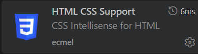
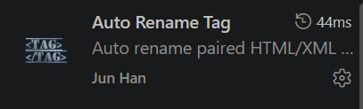
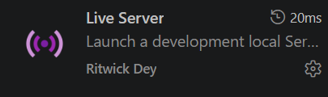
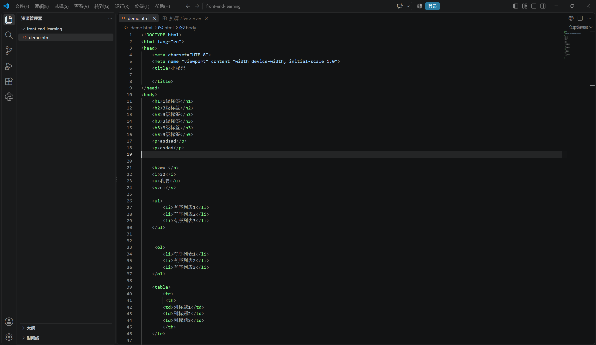
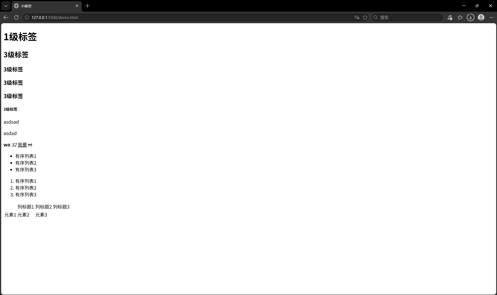

# 网站配置环境
### 可以使用VS Code（后面简称VC）进行html编辑需要在VC插件中安装Auto Rename Tag，HTML CSS Support，Live Server以便我们搭建网页环境。

## 插件介绍
## 1. HTML CSS Support————html编辑器

## 2. Auto Rename Tag————方便在写html时的自动便捷编辑

## 3. Live Server————html编辑内容在网页实时状态（最有用）

## 环境搭建
### 打开VS新建文件夹，在文件夹内创建新的文件，后缀要.html，之后便可在此内编辑

### 如果想要实时显示网站内容样式，可右键打开open with Live Server(这个就是前面Lve Server的作用),就会进入浏览器打开网站显示实时状态。

## 以上完成后，网站的搭建环境就配置好了🤣👍

