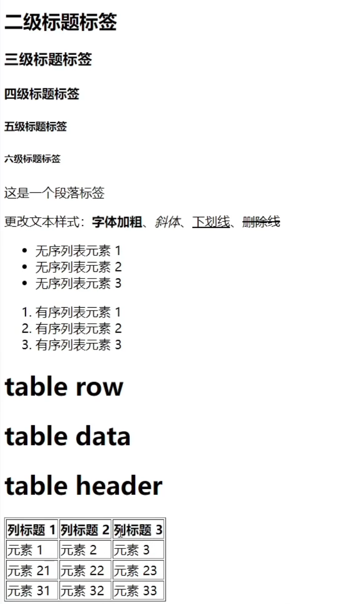

# HTML 常用文本标签 · 学习笔记

> **主要内容**：《常用文本标签》 《HTML 简介及环境搭建》 《HTML 标签属性》
> 
>**目的**：掌握网页里"写字"的标签——标题、段落、文本强调、列表、表格


---

## 一、文本标签总览

| 类别 | 标签 | 作用 | 记忆点 |
|---|---|---|---|
| 标题 | `h1` ~ `h6` | 六级标题，`h1` 最大、`h6` 最小 | 只有 6 个，没有 `h7` |
| 段落 | `p` | 一段文字 | p = paragraph |
| 文本格式化 | `b` / `strong` | 加粗 | b = bold |
| 文本格式化 | `i` | 斜体 | i = italic |
| 文本格式化 | `u` | 下划线 | u = underline |
| 文本格式化 | `s` | 删除线 | s = strikethrough |
| 无序列表 | `ul` + `li` | 圆点列表 | ul = unordered list |
| 有序列表 | `ol` + `li` | 1. 2. 3. 编号列表 | ol = ordered list |
| 表格 | `table` `tr` `td` `th` | 表格的根、行、单元格、表头 | tr = table row，td = table data，th = table header |


---------------------------------------------------------------------------

## 二、标题标签 `h1` ~ `h6`

### -----基本写法

```html
<h1>一级标题</h1>
<h2>二级标题</h2>
<h3>三级标题</h3>
<h4>四级标题</h4>
<h5>五级标题</h5>
<h6>六级标题</h6>
```
`h1` → `h6`，数字越大，字越小、权重越低。整页通常只用一个 `h1`（大标题），其余按层级往下排。

---

## 三、段落标签 `p`

```html
<p>这是一个段落标签</p>
```

- **用法与标题标签完全一致**：同样是"开始标签 + 内容 + 结束标签"。
- **和标题的区别只有两点**：字体更小、**不加粗**。标题标签自带加粗效果，段落不会。
- 段落之间浏览器会自动换行、留出间距（不用自己敲回车）。

---

## 四、文本格式化标签（给文字"加效果"）

在段落里挑中要强调的字，外面套一层标签：

```html
<p>更改<b>文本样式</b></p>
<p>这段文字有<strong>重点</strong>、<i>斜体</i>、<u>下划线</u>和<s>删除线</s></p>
```

| 标签 | 全称 | 效果 |
|---|---|---|
| `b` | bold | 加粗 |
| `strong` | — | 加粗（与 `b` 显示效果相同） |
| `i` | italic | 斜体 |
| `u` | underline | 下划线 |
| `s` | strikethrough | 删除线（文字中间一条横线） |


**这几个标签的真正作用是"突出、强调语境"**，不是用来排版美观的。


-----------------------------------------------------------------------------

## 五、列表标签：无序列表 `ul` 与有序列表 `ol`

### 1. 无序列表（前面是小圆点）

```html
<ul>
  <li>无序列表元素一</li>
  <li>无序列表元素二</li>
  <li>无序列表元素三</li>
</ul>
```

**结构记法**：外层一个 `ul` 包住，里面装若干个 `li`。`li` 有几个，就显示几条。

### 2. 有序列表（前面是 1. 2. 3. 自动编号）

```html
<ol>
  <li>有序列表元素一</li>
  <li>有序列表元素二</li>
  <li>有序列表元素三</li>
</ol>
```

**和无线列表的唯一区别**：把外层 `ul` 改成 `ol`，其余完全一致。编号由浏览器自动生成，不用手打数字。

### 3. 对照表

| | 无序列表 | 有序列表 |
|---|---|---|
| 外层标签 | `ul` | `ol` |
| 子项标签 | `li` | `li` |
| 显示 | 圆点 • | 数字 1. 2. 3. |
| 用法 | 基本完全一致 | 基本完全一致 |

---

## 六、表格标签

### 1. 四层结构，从外到内

```
table（表格根元素）
 └─ tr（一行）
     ├─ th（表头单元格，第一行用）
     └─ td（普通单元格，数据行用）
```

### 2. 各标签含义

| 标签 | 全称 | 中文 | 说明 |
|---|---|---|---|
| `table` | table | 表格 | 最外层根元素，整个表格都装在它里面 |
| `tr` | table row | 表格行 | 一个 `tr` 就是一行 |
| `td` | table data | 表格数据 | 行里面的一个普通单元格 |
| `th` | table header | 表头 | 第一行的单元格用它，文字默认加粗居中 |

**理解思路**：
列表只有"行"的概念；表格**既有行又有列**，所以先分"行"（`tr`），行里再分"格"（`td` / `th`）。第一行是列标题，所以第一行的格子用 `th`，其余用 `td`。

### 3. 一段可运行的完整示例

```html
<table border="1">
  <tr>
    <th>列标题一</th>
    <th>列标题二</th>
    <th>列标题三</th>
  </tr>
  <tr>
    <td>11</td>
    <td>21</td>
    <td>31</td>
  </tr>
  <tr>
    <td>12</td>
    <td>22</td>
    <td>32</td>
  </tr>
</table>
```

### 4. `border` 属性

```html
<table border="1">
```

- 写在 `table` 的**开始标签里面**，值写 1、2、3、4 都可以，数字表示**表格边框的宽度**。
- 不加 `border`，表格默认是"看不见线"的，只有文字对齐的排布。

## 大概就是这个样子的（example）😁


---

## 七、所有来一个举例，可运行的哦

```html
<!DOCTYPE html>
<html lang="zh-CN">
<head>
  <meta charset="UTF-8">
  <title>常用文本标签练习</title>
</head>
<body>
  <h1>我的前端学习笔记</h1>
  <h3>今日进度</h3>

  <p>今天学了<strong>常用文本标签</strong>，包括标题、段落、<i>斜体</i>、<u>下划线</u>和<s>删除线</s>。</p>

  <h4>待掌握清单</h4>
  <ul>
    <li>标题标签 h1~h6</li>
    <li>段落标签 p</li>
    <li>文本格式化标签</li>
  </ul>

  <h4>学习顺序</h4>
  <ol>
    <li>HTML 结构与文本标签</li>
    <li>标签属性、块元素与行内元素</li>
    <li>表单</li>
    <li>CSS 样式</li>
  </ol>

  <h4>本周计划表</h4>
  <table border="1">
    <tr>
      <th>星期</th>
      <th>内容</th>
      <th>完成</th>
    </tr>
    <tr>
      <td>周一</td>
      <td>文本标签</td>
      <td>是</td>
    </tr>
    <tr>
      <td>周二</td>
      <td>标签属性</td>
      <td>否</td>
    </tr>
  </table>
</body>
</html>
```

---
