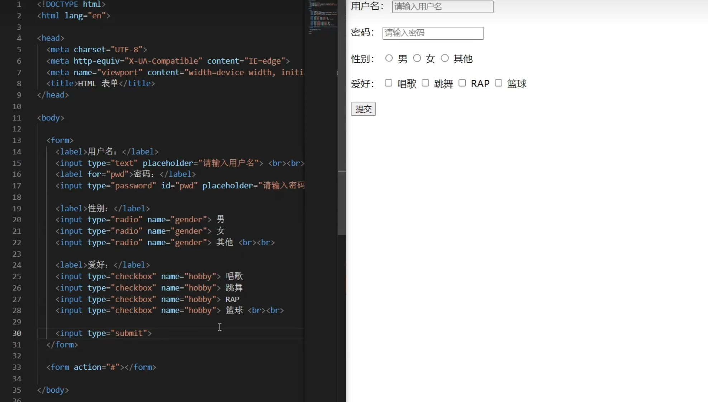

# HTML 表单 · 学习笔记
> **主要内容**：《HTML 表单》
>
> **目的**：掌握表单容器 `form`、输入标签 `input` 的各种类型，以及 `label`、单选多选、提交按钮的用法
---
## 一、表单总览
| 类别 | 标签 / 属性 | 作用 | 记忆点 |
|---|---|---|---|
| 表单容器 | `form` | 装下所有表单元素的大盒子 | form = 表单 |
| 容器属性 | `action` | 提交数据发送到的目标地址 | action = 动作 |
| 输入标签 | `input` + `type` | 最核心的输入控件，类型由 `type` 决定 | input = 输入 |
| 文本框 | `type="text"` | 普通单行输入框（默认值） | text = 文本 |
| 提示文字 | `placeholder` | 灰色提示，输入内容后消失 | placeholder = 占位 |
| 默认值 | `value` | 预填在框里的内容，一直在 | value = 值 |
| 文字说明 | `label` + `for` | 给输入框配文字，点击文字可聚焦 | label = 标签 |
| 密码框 | `type="password"` | 输入显示为圆点加密 | password = 密码 |
| 单选框 | `type="radio"` | 多选一，同组 `name` 必须相同 | radio = 单选 |
| 多选框 | `type="checkbox"` | 可多选，同组 `name` 相同 | checkbox = 复选框 |
| 提交按钮 | `type="submit"` | 把表单数据提交出去 | submit = 提交 |
---------------------------------------------------------------------------
## 二、表单基础
###  什么是表单
表单是网站里**收集用户输入**的交互区域，几乎每个网站都会用到。

**常见场景：**
- 搜索栏输入框
- 城市 / 区域分类选择
- 登录注册页的手机号、验证码输入
- 用户协议勾选


---
## 三、`form` 标签（表单容器）
### 1. 容器作用
- `form` 是表单的根容器，**所有表单元素都必须放在 `form` 标签内部**

### 2. `action` 属性👀👀👀👁️👁️👁️------------------（**重要**）
- 规定点击提交按钮时，填写的数据**发送到哪个地址**（后端提供的接口 URL）
- 暂时没有后端接口时，用 `#` 占位，表示不跳转

```html
<form action="#">
  <!-- 所有表单控件放在这里 -->
</form>
```

---
## 四、`input` 标签（输入标签）
- **单标签**，没有结束标签
- **最重要的属性是 `type`**，它规定了这个输入框具体是什么类型，常用类型有十几种

---
## 五、文本框 `type="text"`
### 1. 基本用法
`text` 是 `type` 的**默认值**，不写 `type` 时就是普通文本框：
```html
<input type="text">
```

### 2. `placeholder` 与 `value` 的区别（容易混）
| 属性 | 作用 | 特点 |
|---|---|---|
| `placeholder` | 提示文字 | 灰色显示，用户一输入内容就自动消失 |
| `value` | 默认值 | 预填在框里的内容，一直保留，用户可修改 |

```html
<input type="text" placeholder="请输入内容">  <!-- 提示，输入后消失 -->
<input type="text" value="请输入内容">        <!-- 默认值，一直在 -->
```

---
## 六、`label` 标签（文字说明）
### 1. 作用
为 `input` 配一段文字说明，作用和 `span` 类似，但**专门和输入框对应使用**。

### 2. `for` 属性
- 把 `label` 和对应的 `input` **绑定**起来
- `for` 的值 = 对应 `input` 的 `id` 值
- 绑定后，点击这段文字，对应的输入框会自动获得焦点

```html
<label for="username">用户名：</label>
<input type="text" id="username" placeholder="请输入用户名">

<label for="pwd">密码：</label>
<input type="password" id="pwd" placeholder="请输入密码">
```

> ⚠️ `id` 每个元素全页唯一；单选框一组选项共用 `name`，不适合用 `id` 绑定。

---
## 七、密码框 `type="password"`
输入的内容显示为圆点（加密状态），不显示明文：
```html
<input type="password" placeholder="请输入密码">
```

---
## 八、单选框 `type="radio"`
### 1. 用途
实现"多选一"效果，比如选择性别。

### 2. 关键点：`name` 分组
要实现真正的**单选互斥**，同一组选项的 `input` 必须设置**相同的 `name` 属性值**：

```html
<label>性别：</label>
<input type="radio" name="gender"> 男
<input type="radio" name="gender"> 女
<input type="radio" name="gender"> 其他
```

> ⚠️ 三个 `input` 的 `name` 都叫 `gender`，这样才能互斥，只能选一个；`name` 不一样就会变成各自独立、能多选。

---
## 九、多选框 `type="checkbox"`
### 1. 用途
实现"多选"效果，比如选择爱好。

### 2. 特点
同一组选项同样设置相同的 `name` 属性：

```html
<label>爱好：</label>
<input type="checkbox" name="hobby"> 唱歌
<input type="checkbox" name="hobby"> 跳舞
<input type="checkbox" name="hobby"> RAP
<input type="checkbox" name="hobby"> 篮球
```

---
## 十、提交按钮 `type="submit"`
### 1. 作用
点击后，把表单里填写的数据提交到 `action` 指定的地址：
```html
<input type="submit">
```

### 2. 自定义按钮文字
按钮默认显示"提交"，可以用 `value` 属性改成其他文字：
```html
<input type="submit" value="上传">
```

---
## 十一、所有来一个举例，可运行的哦
```html
<!DOCTYPE html>
<html lang="zh-CN">
<head>
  <meta charset="UTF-8">
  <title>表单练习</title>
</head>
<body>
  <h1>注册表单</h1>

  <form action="#">
    <!-- 用户名 -->
    <label for="username">用户名：</label>
    <input type="text" id="username" placeholder="请输入用户名">
    <br><br>

    <!-- 密码 -->
    <label for="pwd">密码：</label>
    <input type="password" id="pwd" placeholder="请输入密码">
    <br><br>

    <!-- 性别（单选） -->
    <label>性别：</label>
    <input type="radio" name="gender"> 男
    <input type="radio" name="gender"> 女
    <input type="radio" name="gender"> 其他
    <br><br>

    <!-- 爱好（多选） -->
    <label>爱好：</label>
    <input type="checkbox" name="hobby"> 唱歌
    <input type="checkbox" name="hobby"> 跳舞
    <input type="checkbox" name="hobby"> 篮球
    <br><br>

    <!-- 提交按钮 -->
    <input type="submit" value="提交注册">
  </form>
</body>
</html>
```
看图
